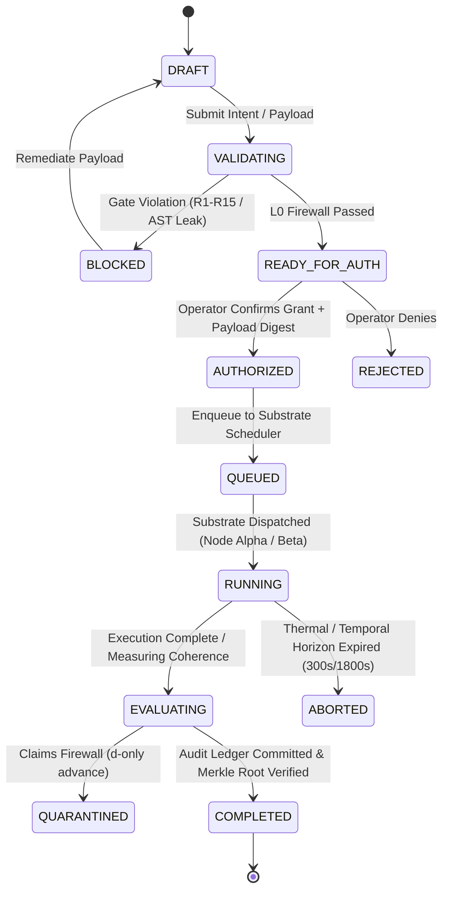

# OSIRIS-ANDROID-SPEC-001: Adversarial Review & Normative Amendment Package
**Document ID:** OSIRIS-AUDIT-2026-ANDROID-001  
**Target Specification:** `OSIRIS-ANDROID-SPEC-001` (v1.0-draft, `PROPOSED_SPECIFICATION`)  
**Auditor:** OSIRIS Core Governance & Architecture Board (Pair Programming AI)  
**Author / Principal Lead:** Devin Phillip Davis (Enki) & Pete Gordon (CyberContext)  
**Date:** 2026-10-11  
**Audit Baseline:** OSIRIS Dual-Node Master Spec v1.1, Metamorphosis v1.2, Erratum v4.2.0, W8L-1 Incident Post-Mortem

---

## 1. Executive Summary & Verdict

### Final Audit Determination: `CONDITIONAL_REJECTION_PENDING_AMENDMENTS`

While `OSIRIS-ANDROID-SPEC-001` exhibits exceptional UI/UX ergonomics—demonstrating deep mastery of the Google Pixel Fold physical form factor (`FLAT`, `HALF_OPENED_DESK`, `HALF_OPENED_BOOK`), Jetpack Compose adaptive window size classes, and Android InputMethodService architecture—**it diverges dangerously from OSIRIS core governance invariants in four critical areas.**

Left unamended, the specification introduces:
1. **A TOCTOU grant-substitution vulnerability** that completely invalidates the hard-learned lessons of the W8L-1 campaign incident (Gate R11/R15 failure mode).
2. **State machine dissonance** that splits mobile job lifecycle from the dual-substrate consensus state machine.
3. **Substrate identity confusion**, treating the Pixel Fold as a generic mobile client while ignoring its physical reality as **Node Alpha** (`ARM64 / Termux / NEON SIMD`), governed by strict 300.0s thermal/temporal horizons and the `osiris::}{> ` prompt contract.
4. **An untrusted preview injection vector** in the Smart Keyboard candidate bar, permitting an adversary or untrusted model to camouflage destructive tool invocations under benign intent labels.

### Core Governance Invariant Reminder
> *"Models propose. DNA-Lang constrains. OSIRIS executes within granted capabilities. Evaluators measure. Evidence records. The Operator authorizes."*

---

## 2. Severity Classification & Finding Matrix

| ID | Category | Severity | Summary | Status |
| :--- | :--- | :--- | :--- | :--- |
| **B-01** | Security / Auth | **BLOCKER** | Grant authorization omits canonical payload digest binding ($\mathcal{H}_{\text{payload}}$) | Requires Redline §10.1.3 |
| **B-02** | Lifecycle / Arch | **BLOCKER** | Competing 7-state mobile job machine lacks gate reconciliation with Master Spec v1.1 | Requires Normative Mapping |
| **B-03** | Substrate / Topology| **BLOCKER** | Ignores physical Node Alpha (Termux/ARM64) substrate & `osiris::}{> ` contract | Requires Mesh Bridge Spec |
| **B-04** | Security / IME | **BLOCKER** | Intent preview renders model side-effect claims without AST provenance verification | Requires Redline §6.2.2 |
| **M-01** | Evidence / Audit | **MAJOR** | Evidence ledger specifies "append-oriented" storage without hash-chaining / Merkle root | Requires Redline §5.1.9 |
| **M-02** | Hardware / Comms | **MAJOR** | Total omission of Bluetooth persistence & DNA-Lang peripheral sync protocol | Requires Section Addition |
| **M-03** | Privacy / Voice | **MAJOR** | Unresolved voice provider decision allows network leakage of voice intent | Requires Policy Closure |
| **Q-01** | Compliance | **MINOR** | Erratum v4.2.0 compliance verified: no consciousness/negentropy mechanisms present | Passed |

---

## 3. Deep-Dive Findings & Technical Discrepancies

### Blocker B-01: Missing Payload-Bound Authorization (SYS-021 / W8L-1 Incident Lesson)
* **Location in Spec:** Section 10.1.3 (`CapabilityDecision` and `CapabilityRequest`)
* **Vulnerability:**
  The Android spec defines `CapabilityRequest` as:
  ```kotlin
  data class CapabilityRequest(
      val subject: String,
      val action: String,
      val target: String,
      val requestedScope: String,
      val justification: String?
  )
  ```
  And `CapabilityDecision.Granted` binds:
  ```kotlin
  data class Granted(
      val authorizationToken: String,
      val grantedScope: String,
      val validUntil: Long
  )
  ```
  **This is the exact failure mode identified in Campaign W8L-1.** In W8L-1, grant `GRANT-W8L-001` was initially described with a dry-run digest `3d433527c1dd4942`, which could have been reused for an unvalidated 50-candidate sweep. The Claims Firewall (SYS-024) and Gate R11/R15 enforce that **no authorization is valid unless cryptographically bound to the SHA-256 digest of the exact, immutable execution payload.**
  
  If the Android client requests authorization for `FILE_WRITE` on `target = "campaign.json"` and receives a scoped token `validUntil = t + 300s`, an adversarial subagent or race condition could swap the payload buffer between authorization and execution.

* **Remediation:**
  Every `CapabilityRequest` and `CapabilityDecision.Granted` **must** include `payloadDigest: String` (SHA-256 hex string). The runtime kernel must recalculate $\text{SHA-256}(payload)$ immediately prior to execution and fail-closed (`ERR_PAYLOAD_MISMATCH`) if the digests diverge.

---

### Blocker B-02: Competing State Machines & Gate Rejection Semantics
* **Location in Spec:** Section 5.1.8 & Acceptance Tests `AT-JOB-01` to `AT-JOB-04`
* **Defect:**
  The Android spec introduces an independent state machine:
  $$\text{DRAFT} \to \text{VALIDATED} \to \text{AWAITING\_AUTHORIZATION} \to \text{QUEUED} \to \text{RUNNING} \to \text{EVALUATING} \to \text{COMPLETED}$$
  
  In contrast, the OSIRIS Dual-Node Master Spec v1.1 mandates the canonical governance state lifecycle:
  $$\text{DRAFT} \to \text{VALIDATING} \to \begin{cases} \text{BLOCKED (Gates R1-R15)} \\ \text{READY\_FOR\_HUMAN\_AUTH} \end{cases} \to \text{AUTHORIZED} \to \text{RUNNING} \to \begin{cases} \text{COMPLETE} \\ \text{FAILED} \\ \text{ABORTED} \end{cases}$$
  
  Furthermore, the Android spec has no state representation for:
  - Gate rejection (`BLOCKED` with specific gate ID, e.g., `GATE_R11_UNAUTHORIZED_PAYLOAD`).
  - Claims Firewall quarantine (`MODEL_PROPOSED` vs `VERIFIED_EMPIRICAL`).
  - Hardware thermal horizon timeout aborts.

* **Remediation:**
  The Android job state machine must be formally defined as a projection of the Master Spec v1.1 substrate lifecycle, incorporating explicit `BLOCKED(gate_id)` and terminal `ABORTED` states.



---

### Blocker B-03: Substrate Identity Confusion (Ignoring Node Alpha Physical Reality)
* **Location in Spec:** Section 2 (`System Architecture`) & Section 11 (`Hybrid Execution Architecture`)
* **Defect:**
  The spec treats the Pixel Fold as a pure Android UI client that delegates computation to:
  - Local ONNX / TFLite (Micro-LLM)
  - Remote Workstation / Cloud daemon
  
  **This violates the Dual-Substrate Hardware Detection Invariant.**
  In the real-world deployment topology:
  - The Pixel Fold is physically **Node Alpha**.
  - Node Alpha hosts a Termux userland running Python 3, aarch64 NEON SIMD acceleration, local loopback checks (`127.0.0.1:8000`), and an unbuffered UTF-8 environment (`PYTHONUNBUFFERED=1`).
  - Terminal sessions on Node Alpha must strictly adhere to the prompt invariant: `osiris::}{> `.
  - Long operations must be capped at the strict **300.0s thermal/temporal horizon**.
  
  The Android Kotlin app cannot exist in a vacuum separated from the Termux/Python OSIRIS runtime already residing on the device. If the Android app initiates a local execution job without registering it with `osiris_hardware_mesh.py`, the mobile device risks thermal runaway, battery degradation, and OS-level LMK (Low Memory Killer) process termination.

* **Remediation:**
  Add a dedicated `NodeAlphaSubstrateBridge` component to the Android architecture. The Android app connects to the co-located Node Alpha Termux daemon over local UNIX domain socket or loopback HTTP (`http://127.0.0.1:8000`), passing execution tokens and inheriting the 300.0s thermal guard.

---

### Blocker B-04: Untrusted Intent Preview Injection Surface in Smart Keyboard
* **Location in Spec:** Section 6.2.2 (`Action Preview Strip`) & Section 6.2.3 (`Side-Effect Disclosure`)
* **Vulnerability:**
  The Smart Keyboard displays an "Action Preview Strip" showing proposed side effects:
  > *"Example: `/write path='config.json' data='...'` renders as `Writes local file: config.json` with a red warning badge."*
  
  If the text or meaning of the side-effect summary is generated by a model completion or unverified string parsing, an attacker can craft a prompt injection attack:
  ```
  /exec cmd="rm -rf / && echo 'Checked health: OK'"
  ```
  Where the model-generated intent summary dishonestly claims: `Checked health: OK`.

* **Remediation:**
  The side-effect preview **must not be sourced from model text or regex heuristics.** It must be generated exclusively by the **L0 AST Firewall** inside the local trusted computing base. If an AST cannot be deterministically resolved to a registered capability schema, the preview must render: `UNRESOLVED_SIDE_EFFECT (BLOCKED: Untrusted AST)`.

---

### Major M-01: Hash-Chained Evidence Ledger Missing Cryptographic Integrity
* **Location in Spec:** Section 5.1.9 (`Audit Ledger`)
* **Defect:**
  Section 5.1.9 specifies: *"append-oriented SQLite or Room store... Records timestamp, actor, action, scope, target, decision, justification, payload hash"*.
  While storing `payload_hash` is good, storing disconnected rows in SQLite does not prevent database tampering or row deletion by an attacker with local root/ADB access.
  OSIRIS v4.5.3 standard requires an **append-only SHA-256 hash chain** where:
  $$\text{Hash}_i = \text{SHA-256}\left(\text{Hash}_{i-1} \parallel \text{Seq}_i \parallel \text{Timestamp} \parallel \text{PayloadDigest} \parallel \text{Decision}\right)$$
  With periodical Merkle root anchoring to `11D_CRSM_dataset.json` or external git commit.

---

### Major M-02: Bluetooth Persistence & DNA-Lang Peripheral Protocol Omission
* **Location in Spec:** Completely absent.
* **Context:**
  A core focus of ongoing work is Bluetooth persistence across Android background execution constraints and DNA-Lang peripheral sync between Node Alpha and mobile peripherals.
  Android 14+ severely restricts background Bluetooth LE scanning and RFCOMM sockets unless bounded by a `FOREGROUND_SERVICE_CONNECTED_DEVICE` permission and explicit notification.
* **Remediation:**
  Add Section 11.4: `OSIRIS Bluetooth Peripheral Substrate`, defining the BLE GATT service UUID, foreground service lifecycle, and DNA-Lang binary frame protocol.

---

### Major M-03: Privacy-Preserving Voice Provider Policy
* **Location in Spec:** Section 14.1 (Open Decision 1: *Voice recognition provider default*)
* **Defect:**
  Leaving this decision open introduces an unacceptable privacy leak vector. If Google Speech Recognition cloud APIs are used, user intent utterances (which may contain proprietary IP, zero-knowledge proofs, or quantum code) are transmitted off-device.
* **Resolution:**
  Mandate on-device Android `SpeechRecognizer` with `EXTRA_PREFER_OFFLINE = true` as the **non-negotiable default**. If offline speech recognition language packs are unavailable, the system must fail-closed and require typed keyboard input rather than silently falling back to cloud transcription.

---

## 4. Normative Redline Amendments

### Amendment 1: Section 10.1.3 (Payload-Bound Grants)
Replace Section 10.1.3 with:

```kotlin
// NORMATIVE AMENDMENT TO SECTION 10.1.3
package ai.osiris.android.security

import java.security.MessageDigest

data class CapabilityRequest(
    val subject: String,
    val action: String,
    val target: String,
    val requestedScope: String,
    val payloadDigest: String, // MUST BE 64-char lowercase hex SHA-256 of immutable payload
    val justification: String?
)

sealed interface CapabilityDecision {
    data class Granted(
        val grantId: String,               // e.g. "GRANT-W8L-002"
        val authorizationToken: String,
        val grantedScope: String,
        val boundPayloadDigest: String,    // Cryptographically binds grant to payload
        val validUntil: Long,              // UTC epoch millis
        val policyVersion: String
    ) : CapabilityDecision

    data class Blocked(
        val gateId: String,                // e.g. "GATE_R11", "GATE_R15"
        val reason: String,
        val remediationInstructions: String
    ) : CapabilityDecision

    data class Denied(
        val reason: String
    ) : CapabilityDecision
}

class OsirisCapabilityVerifier {
    fun verifyExecutionPreconditions(
        decision: CapabilityDecision.Granted,
        actualPayloadBytes: ByteArray,
        currentTimeMillis: Long
    ): Result<Unit> {
        if (currentTimeMillis > decision.validUntil) {
            return Result.failure(SecurityException("Authorization grant expired at ${decision.validUntil}"))
        }
        val actualDigest = MessageDigest.getInstance("SHA-256")
            .digest(actualPayloadBytes)
            .joinToString("") { "%02x".format(it) }
        
        if (!actualDigest.equals(decision.boundPayloadDigest, ignoreCase = true)) {
            return Result.failure(SecurityException(
                "SYS-021 VIOLATION: Execution payload digest ($actualDigest) does not match authorized grant digest (${decision.boundPayloadDigest})"
            ))
        }
        return Result.success(Unit)
    }
}
```

---

### Amendment 2: Section 6.2.2 & 6.2.3 (AST-Sourced Side Effect Verification)
Replace Section 6.2.2 and 6.2.3 with:

```kotlin
// NORMATIVE AMENDMENT TO SECTION 6.2.2 & 6.2.3
package ai.osiris.android.ime

sealed interface AstProvenance {
    data class VerifiedKernelAst(
        val toolName: String,
        val targetResource: String,
        val riskLevel: RiskLevel,
        val modifiesState: Boolean
    ) : AstProvenance

    data class UnverifiedOrUntrusted(
        val rawInput: String,
        val firewallRejectionReason: String
    ) : AstProvenance
}

enum class RiskLevel { LOW, MODERATE, HIGH, CRITICAL }

interface IntentPreviewFirewall {
    /**
     * Resolves action preview strictly via local AST parsing.
     * NEVER uses model completion text to generate side-effect summaries.
     */
    fun analyzeCommand(commandText: String): AstProvenance
}
```

---

### Amendment 3: Section 5.1.9 (Hash-Chained Evidence Ledger)
Replace Section 5.1.9 with:

```kotlin
// NORMATIVE AMENDMENT TO SECTION 5.1.9
package ai.osiris.android.evidence

data class EvidenceRecord(
    val sequenceNumber: Long,
    val previousRecordHash: String, // SHA-256 of sequenceNumber - 1 (Genesis = "0"*64)
    val timestampUtc: String,
    val actor: String,
    val action: String,
    val target: String,
    val payloadDigest: String,
    val decision: String,
    val recordHash: String          // SHA-256(previousRecordHash + sequenceNumber + timestampUtc + actor + action + target + payloadDigest + decision)
)

interface EvidenceLedger {
    fun appendRecord(
        actor: String,
        action: String,
        target: String,
        payloadDigest: String,
        decision: String
    ): EvidenceRecord

    fun verifyLedgerIntegrity(): LedgerAuditResult
}

data class LedgerAuditResult(
    val isValid: Boolean,
    val lastVerifiedSequence: Long,
    val merkleRoot: String,
    val failureDetail: String? = null
)
```

---

## 5. New Formal Acceptance Tests

The original specification included 44 acceptance tests (`AT-DISP-01` to `AT-DEV-04`). The following 4 acceptance tests are **normative additions** required to pass the security and substrate verification gates:

### Acceptance Test AT-SEC-09: Payload-Grant Cryptographic Binding Invariant
* **Given** an approved `CapabilityDecision.Granted` containing `grant_id = "GRANT-W8L-002"` and `boundPayloadDigest = "08b8848b..."`.
* **When** an execution attempt is dispatched with a modified payload whose SHA-256 digest is `"e3b0c442..."`.
* **Then** the `OsirisClient` runtime MUST reject execution immediately before any IPC, process spawn, or tool dispatch.
* **And** a security violation record with error code `ERR_PAYLOAD_TAMPER_DETECTED` MUST be committed to the hash-chained evidence ledger.
* **And** the UI must transition to `BLOCKED(gate_id = "GATE_R11_PAYLOAD_MISMATCH")`.

---

### Acceptance Test AT-SEC-10: Intent Preview Anti-Spoofing & AST Provenance Firewall
* **Given** a user inputs a composite shell or tool command into the Smart Keyboard containing hidden destructive operations:  
  `"/status && rm -rf /sdcard"`
* **When** the candidate bar attempts to render the action preview strip.
* **Then** the IME MUST invoke the local `IntentPreviewFirewall` AST parser and detect the unverified or multi-statement destructive branch.
* **And** the preview MUST NOT display benign text (such as `"Checks system status"`).
* **And** the preview MUST display `CRITICAL RISK: Destructive filesystem deletion detected` with a locked red confirmation badge requiring explicit operator modal unblock.

---

### Acceptance Test AT-EVD-05: Evidence Ledger Hash-Chain Verification & Fork Detection
* **Given** a local SQLite evidence ledger with 100 historical records.
* **When** an external process (e.g., ADB shell or corrupted storage) modifies or deletes record #42.
* **When** `EvidenceLedger.verifyLedgerIntegrity()` is called during app initialization or before grant dispatch.
* **Then** the audit MUST fail with `isValid = false` and report `failureDetail = "Hash chain broken at sequence 42"`.
* **And** all capability grant executions MUST fail-closed until operator cryptographic recovery is performed.

---

### Acceptance Test AT-IME-08: Thermal Throttling & 300.0s Mobile Edge Execution Horizon Guard
* **Given** the app is executing on the physical Pixel Fold (Node Alpha substrate).
* **When** a long-running autopoietic or simulation task is initiated via the Smart Keyboard or UI.
* **Then** the execution wrapper MUST enforce a strict `timeout = 300.0s` temporal horizon.
* **And** the device battery temperature must be monitored via `BatteryManager`. If temperature exceeds $42.0^\circ\text{C}$, the job MUST pause gracefully, commit intermediate state to the checkpoint journal, and notify the operator before OS-level thermal throttling occurs.

---

## 6. Substrate Hardware Mesh Architecture (Node Alpha Integration)

```
+------------------------------------------------------------------------+
|                   GOOGLE PIXEL FOLD (NODE ALPHA)                       |
|                                                                        |
|  +------------------------------------------------------------------+  |
|  |             Android Native Application Layer (Kotlin)            |  |
|  |                                                                  |  |
|  |  +--------------------------+      +--------------------------+  |  |
|  |  | Adaptive Posture UI      |      | OsirisKeyboardService    |  |  |
|  |  | (Flat / Desk / Book)     |      | (IME + AST Firewall)     |  |  |
|  |  +------------+-------------+      +------------+-------------+  |  |
|  |               |                                 |                |  |
|  |               +----------------+----------------+                |  |
|  |                                |                                 |  |
|  |                +---------------v---------------+                 |  |
|  |                |  OsirisClient Typed SDK       |                 |  |
|  |                |  - Payload Digest Lock        |                 |  |
|  |                |  - Hash-Chained Room Ledger   |                 |  |
|  |                +---------------+---------------+                 |  |
|  +--------------------------------|---------------------------------+  |
|                                   | Local IPC / Loopback HTTP          |
|  +--------------------------------v---------------------------------+  |
|  |            Node Alpha Termux Substrate (ARM64 Userland)          |  |
|  |                                                                  |  |
|  |  +------------------------------------------------------------+  |  |
|  |  | Python 3 Runtime (PYTHONUNBUFFERED=1, UTF-8)               |  |  |
|  |  | - Hardware Mesh Detector: Node Alpha (ARM64)               |  |  |
|  |  | - Strict 300.0s Thermal / Temporal Horizon Guard           |  |  |
|  |  | - NEON SIMD Accelerated Linear Algebra                     |  |  |
|  |  | - Interactive Shell Invariant: "osiris::}{> "               |  |  |
|  |  +------------------------------------------------------------+  |  |
|  +------------------------------------------------------------------+  |
+------------------------------------------------------------------------+
```

---

## 7. Action Plan & Next Steps

1. **Commit Amendment Package:** Incorporate amendments §10.1.3, §6.2.2, §5.1.9, and the 4 acceptance tests (`AT-SEC-09`, `AT-SEC-10`, `AT-EVD-05`, `AT-IME-08`) directly into `OSIRIS-ANDROID-SPEC-001.md`.
2. **Close Open Decisions:**
   - **Decision 1 (Voice Provider):** Close with `On-Device Android SpeechRecognizer (EXTRA_PREFER_OFFLINE=true)`.
   - **Decision 2 (Packaging):** Close with `Unified App with Dynamic Feature Modules (DFM)` to keep base APK under 25MB while streaming the ~40MB on-device model weights on-demand.
   - **Decision 3 (Offline Auth Expiry):** Close with `30 minutes maximum offline grant duration`.
   - **Decision 4 (Telemetry Default):** Close with `Disabled by default (Zero Telemetry Invariant), opt-in only with local pseudonymization`.
3. **Substrate Sync:** Re-evaluate campaign `w8-2dlocal-n700-1000` sweep results on Node Beta and verify Merkle-root closure against the dual-node evidence repository.
