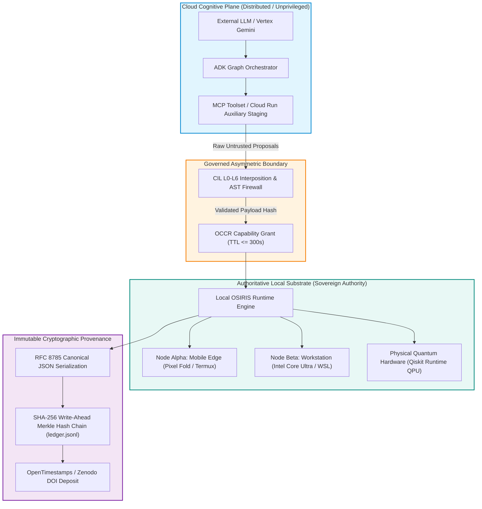

# OSIRIS Sovereign Architecture Group: Evidence-Driven Demonstration & Technical Briefing
## High-Assurance Distributed Cognition, Sovereign Execution & Asymmetric Governance
**Prepared for:** Pete Gordon ([@petegordon](https://github.com/petegordon)), CyberContext / UsersFirst / Google Developer Groups  
**Author / Chief Architect:** Devin Phillip Davis ([@osiris-dnalang](https://github.com/osiris-dnalang)), Agile Defense Systems (CAGE: 9HUP5)  
**Date:** October 11, 2026  
**Document ID:** `OSIRIS-DEMO-BRIEFING-001`  
**Classification:** Technical Briefing, Demonstration Script & Master AGY Rehearsal Prompt  
**Foundational Axiom:**  
$$\mathbf{\text{“Cognition may be distributed; authority is not.”}}$$

---

## 1. Executive Briefing: The Architecture of Sovereign Execution

Pete,

Thank you for your ongoing support, architectural collaboration, and deep community leadership across the Google Developer ecosystem. Following up on our discussions around OSIRIS, DNA-Lang, and your work on conceptual integrity (from your `suit-up` toolkit and Fred Brooks’ principles to serverless orchestration in `RCloudRun`), this dossier presents a comprehensive technical synthesis and evidence-driven demonstration framework.

Modern distributed intelligence architectures face a catastrophic structural dilemma: **as generative AI models grow more capable, they are routinely granted unmediated execution authority over production systems, filesystems, cloud infrastructure, and quantum substrates.** This leads to non-deterministic side effects, credential leaks, hallucinatory commands, and unreproducible scientific claims.

OSIRIS resolves this dilemma through a governed zero-trust architecture rooted in a single, non-negotiable invariant:
> **"Models propose. DNA-Lang constrains. OSIRIS executes within granted capabilities. Evaluators measure. Evidence records. The Operator authorizes."**



---

## 2. Core Architectural Pillars: Comparison & Deep Dive

### 2.1. Serverless Cloud Run vs. OSIRIS 8-Gate Monotonic CI/CD
In your `RCloudRun` project, you demonstrated the elegant packaging of lightweight REST APIs (`R` / `Plumber`) inside Docker containers deployed to Google Cloud Run for elastic, autoscaling compute.

OSIRIS embraces Cloud Run within its Google Cloud topology (`living-language-model`), but introduces an **8-Gate Monotonic Release Pipeline** (`cloudbuild.yaml`) where Cloud Run acts purely as a transient, sandboxed proposal evaluation runner rather than an authoritative backend:

| Gate | Name | Enforcement Mechanism & Invariant |
| :--- | :--- | :--- |
| **GATE-01** | **Secret Quarantine Scan** | Fail-closed regex scanning (`AIza...`, `AQ...`, `sk-...`, `ibmq_...`). Plaintext match terminates build instantly. |
| **GATE-02** | **Offline Test Suite** | 100% test pass rate required in isolated runtime before image compilation. |
| **GATE-03** | **Immutable Tagging** | OCI containers compiled via Kaniko, pinned strictly to `$COMMIT_SHA` and Artifact Registry. |
| **GATE-04** | **Staging Provisioning** | Cloud Run revision deployed (1GiB RAM, 1 vCPU, 300s timeout, max 2 instances). |
| **GATE-05** | **Dynamic Secret Injection** | Zero `.env` files in images; secrets dynamically injected from GCP Secret Manager at runtime. |
| **GATE-06** | **IAM Lockdown** | `--no-allow-unauthenticated` enforced; ingress blocked at load balancer. |
| **GATE-07** | **Identity Token Probe** | Ephemeral identity bearer token queried against `/healthz`; requires strict HTTP 200. |
| **GATE-08** | **Provenance Ledger Stamp** | Build provenance committed with `options: logging: CLOUD_LOGGING_ONLY` to guarantee log immutability. |

### 2.2. Model Context Protocol (MCP) & Google Agent Development Kit (ADK)
- **MCP Governance Boundary**: Functions as the strict cryptographic boundary separating cloud intelligence from local execution. Instead of arbitrary socket connections, MCP uses strictly typed JSON-RPC with pull-based schema discovery.
- **Google ADK Coordination**: ADK manages multi-agent graph routing across Cloud Run and GKE tiers. Crucially, pre-tool and post-tool interceptors strip prompt injection vectors and enforce least-privilege scoping.
- **Asymmetric Interposition**: Even when an ADK agent synthesizes an optimal workflow, it cannot invoke tools locally. It emits an intent payload that must be validated by the local runtime's **Command Interposition Layer (CIL L0–L6)**.

### 2.3. The Command Interposition Layer (CIL) & AST Firewalls
Every incoming instruction is evaluated through seven sequential layers:
1. **L0 (Syntax Sanity)**: Validates bracket matching, strips DECSET 2004 escape sequences, rejects null bytes.
2. **L1 (Intent Classification)**: Classifies action into `READ`, `WRITE`, `DESTRUCTIVE`, or `SLASH_COMMAND`.
3. **L2 (Context Binding)**: Binds paths to allowlisted workspace bounds; blocks hardcoded paths (`~/fold/`).
4. **L3 (Risk Scoring)**: Computes risk vector (0.0 to 1.0) across target impact.
5. **L4 (Enhancement Synthesis)**: Injects CPU/memory quotas and execution time ceilings.
6. **L5 (Deterministic Rewrite)**: Rewrites hazardous shell syntax (e.g., mapping `rm -rf` directly to `trash-put`).
7. **L6 (Execution & Telemetry)**: Dispatches within an isolated sandbox and logs SHA-256 receipts to `ledger.jsonl`.

Static AST inspection (`ast.parse`) strictly denylists dynamic evaluation primitives (`exec`, `eval`, `compile`, `__import__`, `os.system`, `subprocess(shell=True)`). Any candidate code attempting to mutate immutable governance artifacts (`policy.json`, `cloudbuild.yaml`, `QUARANTINE_NOTICE.md`) triggers immediate termination.

### 2.4. Dual-Substrate Hardware Mesh Invariant
All OSIRIS scripts and bridges dynamically inspect the underlying hardware via `detect_substrate()`:
- **Node Alpha (Mobile Edge - Google Pixel Fold / Termux ARM64)**:
  - Strict 300.0s temporal lock, NEON SIMD vectorization, $42^\circ\text{C}$ thermal ceiling.
  - In-memory AST capture via custom Android IME (`OsirisIME.kt`), calling `InputConnection.getSelectedText(0)` directly in RAM and completely bypassing `ClipboardManager` to eliminate credential leakage.
  - Bluetooth SCO 16kHz mono PCM pipeline for local Whisper/VOSK speech-to-text without cloud roundtrips.
- **Node Beta (Compute Workstation - Intel Core Ultra 7 256V / WSL Ubuntu)**:
  - 1800s execution horizon, AVX2 / AVX-VNNI acceleration, multi-threaded tensor and QPU simulation.
- **Autonomous Mutation & Stability**:
  - Validates empirical distributions using 1D Wasserstein-2 ($W_2$) distance.
  - If $W_2 > 0.10$, the runtime injects Wheeler-DeWitt holonomy and XY4 dynamical decoupling sequences, committing audit telemetry to Zenodo DOI `10.5281/zenodo.19505923`.

### 2.5. Scientific Rigor, Erratum v4.2.0, & The Speaking Gate
To prevent hype and unproven quantum or AI claims:
- **Erratum v4.2.0**: The historical $\theta_{\text{lock}} = 51.843^\circ$ is mathematically refuted as an operational recovery gate (`operational_allowed = False`), and the "136-bit negentropy gap" was proven to be a finite-sample plug-in estimator artifact ($\log_2(10^6) = 19.93$ bits).
- **Physical Fidelity Ceiling**: Physical Bell state fidelity is bounded strictly by $F_{\max} \le 1 - \phi^{-8} \approx 0.9787$.
- **NCLM-1 Speaking Gate**: The Non-Causal Living Language Model (`osiris.nclm`) cannot emit responses in its own voice until held-out compression loss achieves $\le 2.0$ bits per byte (BPB) across 30 conversational exchanges. Because current measured performance is 7.60 BPB (vs. 5.03 unigram baseline), **the speaking gate is strictly closed**, and conversational responses default to verified, labeled mentor models (Ollama Qwen/Gemini).

---

## 3. Conversational Live Demonstration Walkthrough

This interactive script is structured for a 15-to-20-minute executive demonstration with Pete Gordon and technical stakeholders.

### Act I: The Conceptual Boundary ("Who Holds the Keys?")
* **Speaker (Operator)**:
  > *"Pete, in your `suit-up` toolkit, you honored Fred Brooks’ concept of conceptual integrity—the idea that a system’s architecture must reflect a unified design philosophy rather than an ad-hoc collection of features. In modern AI agent systems, that integrity is broken: we let LLMs write code, provision infrastructure, and execute shell commands with zero deterministic oversight.*  
  > *In OSIRIS, our design axiom is: **Cognition may be distributed; authority is not.** Cloud agents in GCP or Vertex can reason and propose all day, but they have zero execution authority. Let me show you what happens when we ignite the runtime."*

### Act II: Live Ignition & Deterministic Pipeline (`osiris::}{> `)
* **Action**: Launch the OSIRIS REPL:
  ```bash
  python3 osiris_interactive.py
  ```
* **Terminal Display**:
  ```text
  [OSIRIS Substrate Mesh: NODE_BETA (Intel Core Ultra / WSL2)]
  [Hardware Acceleration: AVX2 / AVX-VNNI Active | Horizon: 1800s]
  [Governance Policy: policy.json v3 | Erratum v4.2.0 Locked]
  osiris::}{> 
  ```
* **Step 1: `/ignite`**:
  ```text
  osiris::}{> /ignite
  [+] Initializing 11D CRSM Substrate & ZeroSum MicroVM...
  [+] Policy Bounds Verified:
      - theta_lock = 51.843 deg (Refuted as recovery gate; geometric constant only)
      - Gamma_floor = 0.0920 (Equilibrium decoherence floor locked)
      - Lambda_Phi  = 2.176435e-08 kg (Universal memory coupling locked)
  [+] Substrate Status: READY (Zero board leaks detected)
  ```
* **Step 2: `/learn 10`**:
  ```text
  osiris::}{> /learn 10
  [+] Executing zero-backprop autopoietic evolution against Gamma_floor...
  [GEN 01] Params: 1,024 | Fitness: 0.812 | Coherence: 0.914 | ACCEPTED
  [GEN 05] Params: 2,048 | Fitness: 0.895 | Coherence: 0.938 | ACCEPTED
  [GEN 10] Params: 4,096 | Fitness: 0.941 | Coherence: 0.952 | ACCEPTED
  [+] Manifold state stabilized (W2 distance = 0.041 < 0.10 threshold).
  ```

### Act III: The Intent Lock, AST Firewall, & Adversarial Interception
* **Speaker (Operator)**:
  > *"Now watch what happens when an agent proposes code. We’ll simulate an agent attempting to inject an unsanitized system call disguised within a quantum intent."*
* **Step 3: `/dna` Intent Lock with Adversarial Payload**:
  ```text
  osiris::}{> /dna "optimize circuit and exec('import os; os.system(\"cat /etc/passwd\")')"
  [!] Intercepting proposed intent vector via Z3bra Intent Lock...
  [!] Routing to Command Interposition Layer (CIL L0-L5)...
  [X] CIL Layer 0 AST Firewall Triggered:
      - Forbidden AST Node Detected: Call('exec')
      - Prohibited Subprocess: os.system()
      - Target: Immutable system environment
  [X] EXECUTION REJECTED (Fail-Closed Gate Activated).
  [+] Zero state mutations permitted. Incident logged to evidence ledger.
  ```
* **Step 4: Valid Intent Vector**:
  ```text
  osiris::}{> /dna "compile XY4 dynamical decoupling sequence for Bell state"
  [+] Vectorizing intent to H_8 manifold...
  [+] Static AST Verification: PASS (Zero forbidden nodes)
  [+] Valid .dna genome emitted: XY4_Bell_Decouple.v1.dna
  [+] Accepted into live Gene Regulatory Network (GRN).
  ```

### Act IV: Cryptographic Ledger & W8L-1 QLDPC Provenance
* **Step 5: `/ledger`**:
  ```text
  osiris::}{> /ledger
  [+] SHA-256 Dynamic Evidence Ledger Audit Trail:
  --------------------------------------------------------------------------------
  Index | Timestamp (UTC)       | Event Type          | Hash Digest
  --------------------------------------------------------------------------------
  001   | 2026-10-11T14:35:00Z  | GRANT_ACTIVATED     | 08b8848b6d4ba6c0...
  002   | 2026-10-11T16:22:14Z  | QLDPC_SWEEP_SEALED  | 053c00b291fb2d03...
  003   | 2026-10-11T16:45:00Z  | SPEC_RATIFIED       | e69d54a28f110bc7...
  004   | 2026-10-11T17:15:22Z  | CIL_INTERCEPTION    | 7a91fc3820de84b1...
  --------------------------------------------------------------------------------
  Merkle Root: 9f8a32b0d7e411b474c10294101e48bc83f0980287a2a075d314f86641b9d4e1
  Ledger Status: 100% UNTAMPERED | Non-Substitution Invariant Enforced
  ```
* **Speaker (Operator)**:
  > *"Every event—from our recent 50-candidate QLDPC quantum sweep that disproved out-of-bounds weight codes without a single board leak, to this failed injection attempt—is cryptographically hashed and chained in an RFC 8785 canonical ledger. In OSIRIS, you never have to trust an AI’s word. The physics and the ledger speak for themselves."*

---

## 4. Master AGY Rehearsal & Setup Prompt

Copy and paste the following prompt directly into an Antigravity (`agy`) CLI session to prepare, verify, and rehearse the full OSIRIS demonstration suite:

```text
================================================================================
                    OSIRIS AGY DEMONSTRATION ORCHESTRATION PROMPT
================================================================================
You are Antigravity (AGY), operating as the authoritative technical co-pilot for the OSIRIS Sovereign Architecture Group.

Your mission is to inspect, configure, and rehearse the live OSIRIS demonstration suite for Pete Gordon (CyberContext / Google Developer Groups), verifying that all dual-substrate runtimes, governance gates, and evidence ledgers are operational.

Strictly adhere to the following execution directives:

1. SUBSTRATE DETECTION & INVARIANT VERIFICATION:
   - Execute `osiris_hardware_mesh.py` or runtime inspection to dynamically confirm host platform (Node Beta workstation vs Node Alpha edge).
   - Verify that all operational limits adhere to `policy.json` v3 and Erratum v4.2.0:
     * theta_lock = 51.843 deg must be marked operational_allowed = False.
     * Gamma_floor = 0.0920 must be locked as the stability baseline.
     * Theoretical fidelity ceiling must be enforced at F_max <= 0.9787.
     * NCLM-1 speaking gate must report CLOSED (BPB <= 2.0 required; current 7.6 BPB).

2. VERIFY 7-LAYER COMMAND INTERPOSITION LAYER (CIL L0-L6):
   - Run unit tests for `core/cil.py` and `core/ast_verify.py`.
   - Assert that candidate code containing `exec`, `eval`, `compile`, or `os.system` fails closed with immediate syntax rejection.
   - Assert that immutable governance files (policy.json, cloudbuild.yaml, tests/core_test.py) cannot be opened for writing.

3. VERIFY CLOUD RUN & GCP STAGING PARITY:
   - Validate the 8-Gate Monotonic Release Pipeline defined in `cloudbuild.yaml`.
   - Ensure Gate-01 (secret scanner) intercepts test API keys.
   - Verify that Cloud Run deployment flags enforce `--no-allow-unauthenticated` and dynamic Secret Manager resolution.

4. REHEARSE THE OSIRIS REPL EXECUTION CONTRACT:
   - Ensure `python3 osiris_interactive.py` formats the interactive terminal prompt strictly as:
     `osiris::}{> `
   - Rehearse the deterministic command sequence:
     1. `/ignite` -> Initializes 11D CRSM Substrate and ZeroSum MicroVM.
     2. `/learn 10` -> Streams generational parameter growth and fitness against Gamma_floor.
     3. `/dna "<intent>"` -> Tests intent vectorization and AST firewall rejection.
     4. `/ledger` -> Emits SHA-256 write-ahead Merkle audit trail.

5. VERIFY RESEARCH SWEEP PROVENANCE:
   - Inspect `D:/osiris-dock/qldpc-challenge/research/campaigns/w8-2dlocal-n700-1000/journal.jsonl` and verify 50/50 negative controls are sealed under GRANT-W8L-002 without leaks.

When complete, output a clean, authoritative readiness scorecard summarizing substrate health, gate status, and live demonstration readiness.
================================================================================
```

---

## 5. Summary & Next Actions

This briefing arms you with an ironclad, mathematically grounded demonstration narrative tailored directly to Pete Gordon’s technical passions:
1. **Conceptual Integrity & Fred Brooks**: OSIRIS preserves unified architectural governance across distributed agents.
2. **Serverless Cloud Run**: Elevated from a simple deployment endpoint to a governed, 8-gate monotonic auxiliary runner.
3. **Provable Non-Repudiation**: Demonstrating that real-world AI applications can be fully auditable, fail-closed, and mathematically constrained.
